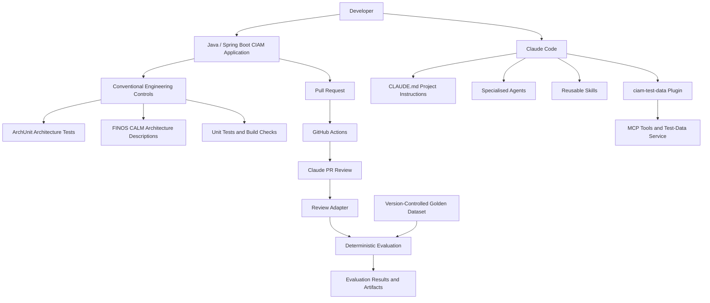
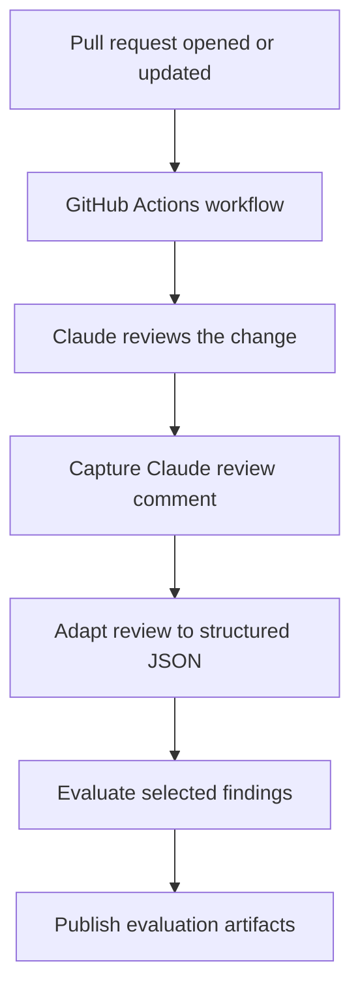
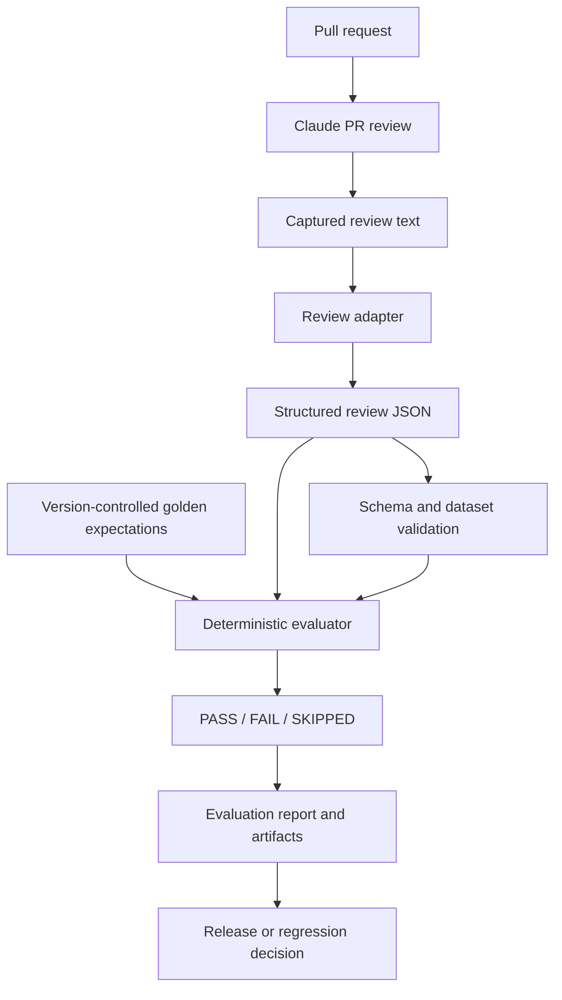

# Claude CIAM SDLC — AI-Assisted Software Engineering with Architecture Guardrails

An experimental engineering project exploring how Claude Code, specialised agents and skills, MCP tools, architecture-as-code, automated pull-request reviews, and deterministic evaluation can improve the software development lifecycle for a Java/Spring Boot Customer Identity and Access Management (CIAM) application.

The central design principle is:

> **Use AI to assist with reasoning and investigation, deterministic engineering controls to enforce rules, and repeatable evaluation to measure whether AI behaviour remains reliable as models and code evolve.**

This repository explores how to integrate AI into an existing engineering discipline rather than treating an LLM as a replacement for conventional software engineering practices.

## Table of contents

- [1. Project objectives](#1-project-objectives)
- [2. Solution architecture](#2-solution-architecture)
- [3. Architecture guardrails](#3-architecture-guardrails)
- [4. Claude Code project instructions](#4-claude-code-project-instructions)
- [5. Agents, skills, plugins and MCP](#5-agents-skills-plugins-and-mcp)
- [6. AI-assisted pull-request review](#6-ai-assisted-pull-request-review)
- [7. Deterministic evaluation and regression testing](#7-deterministic-evaluation-and-regression-testing)
- [8. Golden evaluation datasets](#8-golden-evaluation-datasets)
- [9. End-to-end workflows](#9-end-to-end-workflows)
- [10. Repository structure](#10-repository-structure)
- [11. Technologies and engineering practices](#11-technologies-and-engineering-practices)
- [12. Running and validating the project](#12-running-and-validating-the-project)
- [13. Limitations and future improvements](#13-limitations-and-future-improvements)

## 1. Project objectives

The project explores several complementary ways to introduce AI into a CIAM software delivery lifecycle.

### 1.1 Architecture-aware development

Use conventional architecture tests and machine-readable architecture descriptions to make architectural expectations explicit and reviewable.

### 1.2 Reusable AI engineering guidance

Use Claude Code project instructions, specialised agents, skills, plugins and MCP integrations to provide repeatable development capabilities rather than relying on ad hoc prompts.

### 1.3 AI-assisted pull-request review

Use Claude to inspect code changes and identify potential security, API design and architectural problems as part of a GitHub Actions workflow.

### 1.4 Measurable AI quality

Convert review output into a structured format and evaluate it against predefined expectations. This creates a foundation for regression testing when the model, prompts, agent instructions, tools or application code change.

### 1.5 Controlled autonomy

Combine fixed CI/CD stages and deterministic checks with AI-assisted reasoning where interpretation is useful. Keep the overall process bounded, observable and auditable.

## 2. Solution architecture

The solution combines a conventional Java engineering environment with an AI-assisted development and review layer.



The diagram represents the logical architecture and intended integration points. The exact set of checks executed in a particular workflow run depends on the configured GitHub Actions job and its conditions.

### Architectural principle: deterministic controls plus AI assistance

Not every engineering task needs an LLM.

| Engineering concern | Preferred mechanism | Reason |
|---|---|---|
| Compilation and type correctness | Compiler and build | Deterministic verification |
| Unit and integration behaviour | Automated tests | Repeatable assertions |
| Architectural dependency constraints | ArchUnit | Enforceable architectural rules |
| Architecture documentation | FINOS CALM descriptions | Structured architecture representation |
| Code-change interpretation | Claude review | Language understanding and contextual reasoning |
| Test-data discovery | Plugin and MCP tools | Reusable access to a defined capability |
| Review-output regression | Golden datasets and evaluator | Consistent comparison against known expectations |

Claude complements these controls; it does not replace them.

## 3. Architecture guardrails

### 3.1 ArchUnit

ArchUnit is used to express architectural constraints as executable tests in the Java codebase.

Traditional architecture documentation can become outdated when implementation changes. Architecture tests help make selected rules executable so that violations can be detected during development or CI.

Example architectural constraints include:

- Controllers should not directly depend on persistence repositories.
- Dependencies should follow the intended package or layer boundaries.
- Domain and application responsibilities should remain appropriately separated.
- New code should not introduce prohibited dependencies between layers.

For example, a controller that directly injects a repository can bypass a service or application layer. An architecture test can detect that dependency without requiring Claude to infer whether it is acceptable.

**Why this matters:** Claude can explain the architectural implications of a change, while ArchUnit provides a repeatable pass/fail check for rules that can be encoded.

### 3.2 FINOS CALM

FINOS Common Architecture Language Model (CALM) provides a structured way to represent architecture information in a machine-readable form.

Within this project, CALM is an architectural documentation and governance approach that can complement conventional code and tests.

Architecture descriptions can capture concepts such as:

- System components and their responsibilities.
- Relationships and communication paths.
- Interfaces and integration boundaries.
- Trust boundaries and security-relevant relationships.
- Architectural context for reviewing changes.

The value is not simply producing another diagram. Structured architecture descriptions can provide a consistent reference for developers, reviewers and automation.

For example, a proposed API change may look correct in isolation but introduce a dependency or communication path that conflicts with the intended system architecture.

### 3.3 Combining ArchUnit and CALM

These approaches address different aspects of architecture governance.

| ArchUnit | FINOS CALM |
|---|---|
| Checks selected properties of the implemented Java code | Represents architecture in a structured description |
| Enforces executable dependency constraints | Documents components, relationships and architectural intent |
| Produces automated test results | Provides architecture context for people and tooling |
| Best suited to rules that can be expressed against code | Best suited to representing architecture and its relationships |

They are complementary rather than interchangeable. A CALM description does not automatically enforce a Java dependency rule, and an ArchUnit test does not by itself describe the entire enterprise architecture.

## 4. Claude Code project instructions

### 4.1 What is `CLAUDE.md`?

`CLAUDE.md` is a project-level instruction file that Claude Code can use as context when working in the repository.

It provides persistent project guidance so developers do not have to repeat the same instructions in every prompt.

Depending on the content configured in the repository, it can describe:

- The purpose and structure of the application.
- Important architectural boundaries.
- Coding and testing conventions.
- Security and privacy requirements.
- Commands used to build, test and validate changes.
- Expectations for reviewing code and proposing modifications.
- Instructions for using repository-specific agents, skills and tools.

For a CIAM application, the guidance should emphasise security-sensitive design, including authentication and authorisation boundaries, PII handling, secure logging, API contracts and appropriate tests.

### 4.2 Instructions are not enforcement

`CLAUDE.md` guides Claude; it is not a security boundary.

If a rule must always be enforced, implement it using the appropriate control, such as:

- Automated tests.
- ArchUnit rules.
- Static analysis.
- Build or CI checks.
- Access controls and tool permissions.
- Deterministic validation logic.

For example, an instruction can tell Claude not to log customer email addresses. A test, static-analysis rule or other enforceable control can independently detect prohibited logging patterns.

This separation avoids relying on the model to remember and correctly enforce every requirement.

## 5. Agents, skills, plugins and MCP

These mechanisms provide different ways to organise reusable AI capabilities.

### 5.1 Agents

An agent is a specialised AI worker given a defined responsibility and relevant instructions or tools.

Agents are useful when a task benefits from focused context, a specific role or a bounded investigation.

Examples of possible CIAM engineering responsibilities include:

- Reviewing a code change for security issues.
- Investigating architectural dependencies.
- Assisting with test-data selection.
- Helping create or explain tests.

A specialist agent is not automatically a separate model or an autonomous production service. Its behaviour depends on how it is configured and invoked.

### 5.2 Skills

A skill packages reusable instructions and domain-specific guidance for a particular task.

A skill can explain a repeatable procedure, the relevant conventions, the expected inputs and outputs, and the checks that should be performed.

For example, a test-data selection skill can guide Claude through selecting an appropriate synthetic customer scenario before generating a test.

**Difference:** an agent describes a specialised worker or role; a skill describes reusable task knowledge or a procedure. They can be used together.

### 5.3 Plugins

A Claude Code plugin packages reusable capabilities into a distributable unit. Depending on its configuration, a plugin can include agents, skills, MCP configuration and other supported components.

This project includes a `ciam-test-data` plugin intended to support CIAM test-data workflows.

The plugin separates reusable engineering capability from the individual application repository, making it easier to maintain and distribute the same capability across projects.

### 5.4 MCP

The Model Context Protocol (MCP) provides a standard interface through which an AI application can discover and invoke tools exposed by an MCP server.

Rather than asking Claude to invent test data or assume that a customer exists, the application can expose a defined operation such as finding a suitable synthetic test customer.

A simplified flow is:

1. Claude receives a test-generation request.
2. The relevant agent and skill guide the task.
3. Claude identifies the need for a test customer.
4. The configured MCP integration exposes the relevant tool.
5. The tool returns the available test-data result.
6. Claude uses the returned information when helping generate the test.

Tool access, input validation, service availability and data handling remain application and infrastructure responsibilities.

### 5.5 Plugin distribution

The plugin development repository and marketplace repository have different roles:

- **Plugin development repository:** `sanjivsingh79/claude-ciam-sdlc-plugin` — the local development directory is `C:\Users\sanji\claude-ciam-sdlc-plugin`. Verify the actual GitHub repository URL before publishing links that depend on it.
- **Marketplace repository:** `sanjivsingh79/ciam-plugin-marketplace` — contains the marketplace catalog and packaged plugin.

The marketplace catalog references the packaged plugin using a relative path. The packaged copy must be updated when the source plugin changes.

The marketplace distributes the plugin configuration and instructions; it does not automatically deploy external MCP servers or supporting CIAM services.

## 6. AI-assisted pull-request review

The Claude PR Review workflow integrates an AI-assisted review into GitHub Actions.

The goal is to detect and explain potential issues in a proposed code change, then process the resulting review in a structured and testable way.

### 6.1 Review lifecycle



This is a logical representation of the configured processing stages. The workflow also needs to handle unsuccessful steps, missing comments and incomplete results.

### 6.2 Why capture and adapt the review?

A human-readable review comment is useful to a developer, but it is not an ideal format for automated comparison.

The review adapter converts the captured output into a structured representation that can be evaluated by code.

Structured findings can contain attributes such as:

- Finding description.
- Severity.
- Security or architecture rule.
- Evidence supporting the finding.
- Recommendation for remediation.

The adapter helps separate model-generated prose from the data contract expected by the evaluator.

The evaluator should validate the structured result rather than assume that a plausible-looking review is correct.

### 6.3 Workflow resilience

The workflow was adjusted so that capturing the review can run even when the Claude action reports failure, and downstream steps can run when their prerequisites succeed.

This matters because an action may produce a review comment before returning a failure status—for example, when its configured turn limit is exceeded.

The downstream stages should not blindly run without their inputs. The capture, adaptation and evaluation stages therefore use explicit step outcomes to control execution.

A successful evaluation does not necessarily mean the entire GitHub Actions run succeeded. The underlying Claude action may still fail, and that status must be understood separately.

## 7. Deterministic evaluation and regression testing

This is a central part of the project.

LLM output can vary when any of the following changes:

- The model or model version.
- The system prompt or `CLAUDE.md` instructions.
- Agent or skill instructions.
- Tool definitions or MCP behaviour.
- The application code or context provided to the model.
- The review prompt, orchestration or workflow configuration.

A successful review on one pull request does not prove that future versions will behave consistently.

### 7.1 Golden datasets

A golden dataset contains predefined, reviewed expectations for known scenarios.

Each case describes the relevant scenario and the expected properties of the result. These expectations are version-controlled so that changes can be reviewed like other engineering assets.

Examples include:

- A security scenario involving PII logging.
- An architecture scenario involving controller-to-repository dependencies.
- An API-design scenario involving a customer lookup contract.

The expected result is an engineering reference, not a claim that the LLM must produce exactly the same wording every time.

### 7.2 Evaluation architecture



The diagram describes the intended evaluation pattern. The exact release-gating policy depends on how evaluation is configured in CI.

### 7.3 What is evaluated?

The current evaluation pattern checks individual properties of a finding rather than comparing entire paragraphs of prose.

For the exercised `SEC-001` case, the evaluator checked:

| Dimension | What it verifies |
|---|---|
| Finding | Whether the expected issue is identified |
| Severity | Whether the assigned severity matches the expectation |
| Rule | Whether the finding maps to the expected rule |
| Evidence | Whether supporting evidence is present |
| Recommendation | Whether a remediation recommendation is present |

Each dimension has an explicit result. The evaluator returns a process exit code that CI can use to distinguish passing from failing evaluations.

This is intentionally more repeatable than asking another LLM whether the first LLM's answer “looks good”.

### 7.4 Why not compare the entire review text?

LLMs can describe the same issue in different words while preserving the underlying meaning. Exact text comparison would flag many harmless wording changes.

Instead, the evaluator operates on structured findings and explicit expectations. This makes it possible to measure specific behaviours while tolerating legitimate variation in phrasing.

The current checks are a useful foundation, not a complete measure of review quality. Further evaluation can include:

- False negatives: expected issues that were missed.
- False positives: findings raised where no issue exists.
- Severity misclassification.
- Incorrect rule mapping.
- Evidence quality and traceability.
- Duplicate findings.
- Recommendation correctness.
- Coverage across different types of changes.

A complete quality framework needs both positive and negative examples. It should also distinguish an issue that was genuinely absent from one that the model failed to detect.

### 7.5 Regression testing after model or prompt changes

A controlled regression process can be organised as follows:

1. Keep the golden dataset and evaluator under version control.
2. Record the model, prompt, agent/skill versions and relevant configuration used for a baseline.
3. Run the same representative scenarios against the candidate version.
4. Adapt outputs to the same structured schema.
5. Compare results using deterministic checks.
6. Report changes in findings, severity, rule mapping and evidence.
7. Review regressions before promoting the new configuration.

This supports comparisons across model upgrades, prompt revisions, tool changes and application changes.

It does not guarantee that a model will behave identically in production. It gives the team a repeatable way to detect changes against a known set of scenarios before accepting them.

## 8. Golden evaluation datasets

The evaluation assets are organised by scenario category:

```text
evaluation/
├── adapt_claude_review.py
├── evaluate_results.py
├── validate_dataset.py
├── schemas/
│   └── claude-review-result.schema.json
├── golden-dataset/
│   ├── security/
│   │   └── security-pii-logging.json
│   ├── architecture/
│   │   └── architecture-controller-repository.json
│   └── api-design/
│       └── api-valid-customer-lookup.json
├── mock-results/
└── real-results/
```

The exact contents of the repository should be checked against this illustrative structure before treating it as an exhaustive file inventory.

### Golden dataset versus real review output

These assets serve different purposes:

- **Golden dataset:** expert-approved expected behaviour used as a regression reference.
- **Mock results:** controlled inputs for testing the adapter and evaluator without a model call.
- **Real results:** captured outputs from actual review runs, useful for inspecting behaviour and debugging the pipeline.

Real model output should not automatically become golden data. It should be reviewed and approved before being adopted as an expected result.

### Interpreting an evaluation result

A previous PR 2 evaluation reported:

```text
Evaluation: SEC-001
finding: PASS
severity: PASS
rule: PASS
evidence_present: PASS
recommendation_present: PASS

Overall: PASS
Evaluator exit code: 0
```

This means the supplied structured finding satisfied the five configured checks for that evaluation.

The run also noted that PR 2 was a related real-PR scenario rather than an exact match for the `SEC-001` code change. That distinction matters: a passing result demonstrates that the checks passed for the supplied data, not that every possible regression has been covered.

## 9. End-to-end workflows

The project explores two related but distinct engineering workflows.

### 9.1 AI-assisted development and test generation

```text
Developer request
       |
       v
Claude Code + CLAUDE.md
       |
       v
Agent / Skill / Plugin
       |
       v
MCP test-data capability
       |
       v
Synthetic customer test data
       |
       v
Generated or updated tests
       |
       v
Build and test execution
```

This workflow uses AI to assist with test development while keeping test execution and assertions in conventional engineering tools.

### 9.2 AI-assisted pull-request review

```text
Pull request
     |
     v
GitHub Actions
     |
     v
Claude review
     |
     v
Capture comment
     |
     v
Adapt to structured JSON
     |
     v
Evaluate against expected behaviour
     |
     v
Report results and retain artifacts
```

The two workflows can share engineering conventions, repository context and reusable tooling, but they solve different problems.

The plugin supports test-data workflows; the review pipeline examines proposed code changes and evaluates the resulting findings.

## 10. Repository structure

The repository combines application code, architecture assets, Claude Code configuration and evaluation tooling.

An illustrative high-level layout is:

```text
claude-ciam-sdlc/
├── CLAUDE.md
├── .claude/
│   ├── agents/
│   ├── skills/
│   └── settings.json
├── .claude-plugin/
├── .mcp.json
├── .github/
│   └── workflows/
│       └── claude-review.yml
├── evaluation/
│   ├── adapt_claude_review.py
│   ├── evaluate_results.py
│   ├── validate_dataset.py
│   ├── schemas/
│   ├── golden-dataset/
│   ├── mock-results/
│   └── real-results/
├── src/
│   ├── main/
│   └── test/
└── README.md
```

This is a conceptual inventory, not a guaranteed exact tree. Preserve the actual paths and filenames in the repository when updating this document; do not create placeholder directories solely to match the illustration.

## 11. Technologies and engineering practices

The project brings together conventional application engineering and AI-assisted development capabilities.

| Area | Technology or approach |
|---|---|
| Application | Java and Spring Boot |
| Architecture tests | ArchUnit |
| Architecture description | FINOS CALM |
| AI-assisted development | Claude Code |
| Project-level guidance | `CLAUDE.md` |
| Reusable AI capabilities | Agents and skills |
| Plugin integration | Claude Code plugins |
| Tool integration | Model Context Protocol (MCP) |
| CI/CD | GitHub Actions |
| Review-output processing | Python adapter and evaluator |
| Evaluation contracts | JSON Schema |
| Regression references | Version-controlled golden datasets |
| Outputs | Evaluation reports and GitHub Actions artifacts |

## 12. Running and validating the project

The exact commands depend on the current checkout, local environment, configured services and workflow inputs. Use the existing project scripts and workflow as the source of truth.

### 12.1 Conventional application checks

Run the application's configured build and tests. Where applicable, include:

- Compilation and unit tests.
- Integration tests.
- ArchUnit tests.
- Any configured static-analysis and security checks.

A passing AI review must not be used as a substitute for these checks.

### 12.2 Validate evaluation assets

Use the repository's dataset validator and schema to check the golden dataset and structured review contracts.

For example, if the scripts expose command-line entry points, inspect their help or usage instructions before invoking them:

```powershell
python evaluation/validate_dataset.py --help
python evaluation/evaluate_results.py --help
```

Use the supported arguments documented by the actual scripts; the examples above are intended to discover their interfaces, not to assert that every script implements a `--help` option.

### 12.3 Test without unnecessary model calls

Use mock review results to exercise the adapter and evaluator first.

This provides a low-cost way to validate:

- Input parsing.
- JSON structure and schema handling.
- Expected finding matching.
- PASS/FAIL behaviour.
- Exit codes and report generation.

Only run a live Claude review when testing behaviour that cannot be established using deterministic inputs, such as model-generated findings or changes in model behaviour.

### 12.4 Run the GitHub Actions review

The Claude PR Review workflow is defined in:

`.github/workflows/claude-review.yml`

Inspect the workflow's configured trigger and inputs before running it. A live review can consume API usage, and the Claude action may fail independently of later processing stages.

Review the status of each stage separately: Claude execution, comment capture, adaptation, evaluation and artifact upload.

## 13. Limitations and future improvements

This project is an engineering exploration. Its current capabilities should not be confused with a fully production-hardened AI review platform.

Potential improvements include:

1. **Broader evaluation coverage:** add positive and negative golden cases across security, API design and architecture.
2. **Precision and recall measurement:** track missed expected findings and unsupported findings rather than relying only on individual matching checks.
3. **Versioned evaluation baselines:** record model identifiers, prompts, agent/skill versions and tool configuration alongside results.
4. **Quality thresholds:** establish explicit acceptance criteria for candidate model or prompt changes.
5. **CI release gates:** decide which failures should block a merge and which should produce advisory results.
6. **Cost and latency tracking:** capture token usage, execution time, tool calls and failures.
7. **Prompt-injection resilience:** test hostile or misleading instructions contained in code, comments, test fixtures and retrieved content.
8. **Security and permissions:** apply least privilege to tokens, tools and workflows; keep secrets out of source control.
9. **Operational resilience:** use bounded retries, timeouts, explicit failure handling and observable execution states.
10. **Architecture traceability:** connect architecture requirements, CALM descriptions, ArchUnit tests and review rules where a meaningful relationship exists.
11. **Human review:** retain developer judgement for ambiguous or consequential findings.
12. **Plugin packaging validation:** verify that the development and marketplace copies remain synchronised and that required MCP services are available.

## Conclusion

The project demonstrates a practical approach to integrating AI into a conventional engineering lifecycle.

Claude Code, agents, skills, plugins and MCP can make development tasks more contextual and reusable. ArchUnit and structured architecture descriptions provide complementary architectural guardrails. GitHub Actions orchestrates the review lifecycle, while deterministic evaluation checks whether the resulting findings meet predefined expectations.

The most important principle is that **AI output should be treated as a candidate result to validate, not as an automatically trusted source of truth**.

By combining AI-assisted reasoning with executable engineering controls and version-controlled regression cases, teams can evolve models, prompts and tools while retaining a repeatable way to detect quality regressions.
